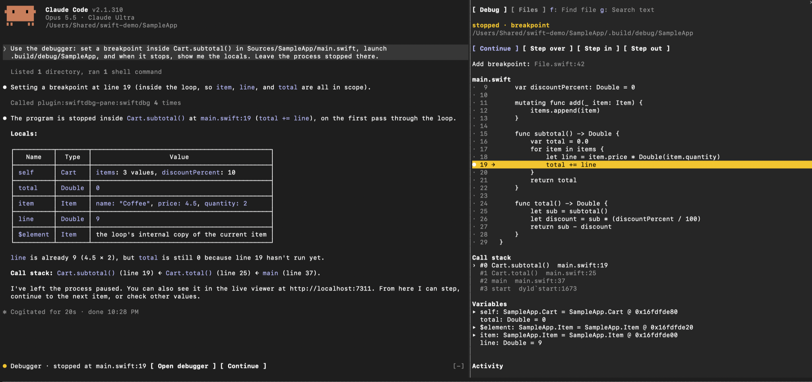
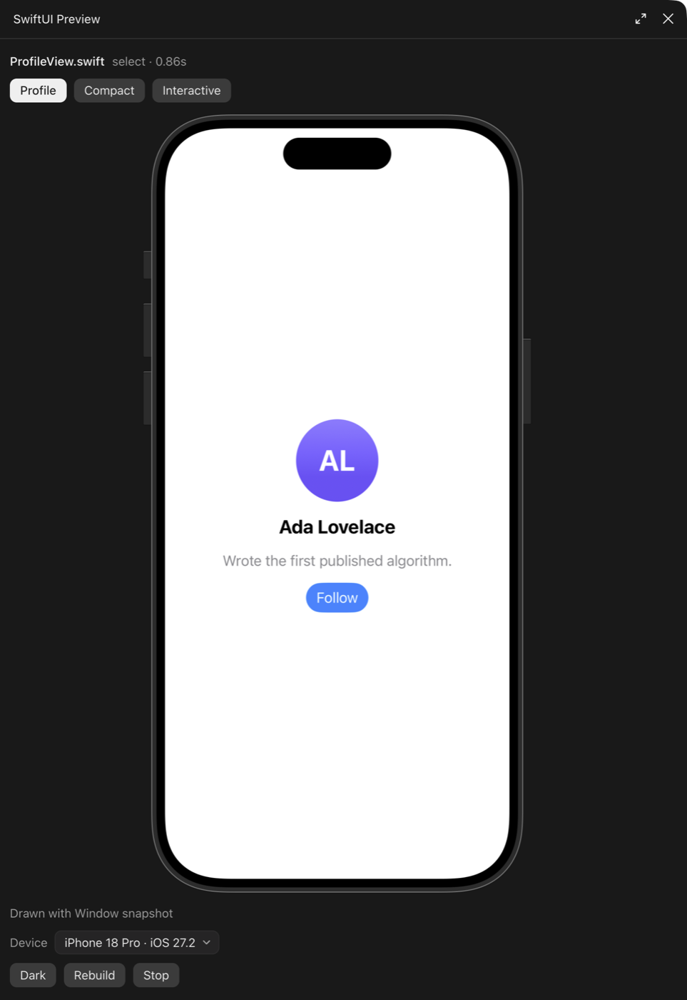

# swift-agent-tools

Tools that let coding agents see and debug the Swift apps they write.

- **SwiftUI previews for Bazel**: render any `#Preview` from a rules_swift /
  rules_apple project, on macOS or an iOS simulator. Hot reload in about a
  second, with no Xcode canvas and no generated `.xcodeproj`.
- **swiftdbg**: drive LLDB (breakpoints, stepping, variables, expressions) on a
  Swift process or an iOS simulator app. You follow and drive the same
  session in a live viewer.

Each tool is an **MCP server**, so any agent that speaks MCP can use it
(Claude Code, Codex, Cursor and others). On top of that, `integrations/claude-code` adds
Claude Code plugins with panes beside the chat.



## Layout

```
tools/swiftpreview/        Swift CLI + MCP server for previews (serve, snapshot, mcp, devices)
runtime/                   SwiftPreviewRuntime, linked into the preview host app
previews/defs.bzl          swiftui_preview_host Bazel macro (this repo is the Bazel module)
tools/swiftdbg/            Python MCP server for LLDB (lldb-dap) + the live web viewer
integrations/mcp.json      MCP config for any agent
integrations/claude-code/  Claude Code plugins: swiftui-previews, swiftdbg-pane
examples/                  ios, macos, macos_clt (Bazel preview hosts), swiftpm (debugger sample)
docs/                      design notes and guides
```

The rule: everything an agent can do lives under `tools/` and is reachable
over MCP, or as a CLI with JSON output. The Claude Code plugins only add what
needs the Claude Code UI: panes, slash commands, status and toasts, and a
note to Claude after each Swift edit saying whether the preview reloaded.

## Requirements

- macOS with Xcode (for iOS and SwiftUI macros), or the Command Line Tools for
  macOS-only previews.
- Previews: Bazel (or bazelisk) with rules_swift and rules_apple.
- swiftdbg: Python 3.9+ (standard library only) and `xcrun lldb-dap`.

## Build

```bash
cd tools/swiftpreview && swift build -c release
```

swiftdbg needs no build.

## Use from any MCP agent

Copy [integrations/mcp.json](integrations/mcp.json) into your agent's MCP
config, with `/path/to/swift-agent-tools` replaced by this checkout's path:

| Server | Command | Tools |
|---|---|---|
| `swiftpreview` | `tools/swiftpreview/.build/release/swiftpreview mcp` | `swiftui_preview`, `swiftui_preview_discover`, `swiftui_preview_list`, `swiftui_preview_devices` |
| `swiftdbg` | `python3 tools/swiftdbg/server.py` | `debug_set_breakpoints`, `debug_launch`, `debug_attach`, `debug_step`, `debug_continue`, `debug_variables`, `debug_evaluate`, … |

`swiftui_preview` returns the rendered PNG inline, so the agent sees the UI
it just changed. When the agent's own pane, or a preview a person started,
is open for the same workspace, it renders there, so both see the same frame.
It never renders in another agent's preview. swiftdbg serves its live
viewer at http://localhost:7311 (set `SWIFTDBG_PORT` to change it).

## Use from Claude Code

```
/plugin marketplace add <owner>/swift-agent-tools
/plugin install swiftui-previews@swift-agent-tools
/plugin install swiftdbg-pane@swift-agent-tools
```

- **swiftui-previews**: `/preview path/to/View.swift` opens a pane that hot
  reloads on every save, with buttons for each preview, light and dark, the
  iOS simulator and Rebuild. It lists every preview in the workspace, so you
  can switch to one or open it in a new tab (`/preview new File.swift`), and
  the file name opens the source in Xcode, VS Code or Cursor. Set the plugin's
  `swiftpreviewPath` option to the CLI you built, unless `swiftpreview` is on
  your `PATH`.
- **swiftdbg-pane**: the pane opens when Claude starts a debug session. It
  shows the source with breakpoints, the call stack and variables, with
  Continue and Step buttons. `/swiftdbg` opens it, and `/swiftdbg break
  File.swift:42` sets a breakpoint. The plugin starts the swiftdbg server itself.



To work on the plugins, load them from this checkout:

```bash
claude --plugin-dir integrations/claude-code/swiftui-previews --plugin-dir integrations/claude-code/swiftdbg-pane
```

## Docs

- [SwiftUI previews: setup, CLI, MCP, what hot reloads](docs/swiftui-previews.md)
- [Previews design and prior art](docs/DESIGN.md)
- [swiftdbg](tools/swiftdbg/README.md)
- [Debugging builds from other machines](docs/debugging-builds-from-other-machines.md)

## Tests

```bash
cd tools/swiftpreview && swift test
```

End to end: builds a real four-module Bazel workspace and drives `swiftpreview serve` through edits at each layer, an unwatched module, a stored property, added and removed files and a BUILD edit, in both watch modes. It takes about a minute once the workspace is cached (see `tools/swiftpreview/Tests/SwiftPreviewE2ETests`):

```bash
cd tools/swiftpreview && swift build && SWIFTPREVIEW_E2E=1 swift test --filter SwiftPreviewE2ETests
```

```bash
cd examples/swiftpm && swift build && python3 ../../tools/swiftdbg/smoke_test.py
```

```bash
claude plugin test integrations/claude-code/swiftui-previews
```

```bash
claude plugin test integrations/claude-code/swiftdbg-pane
```
