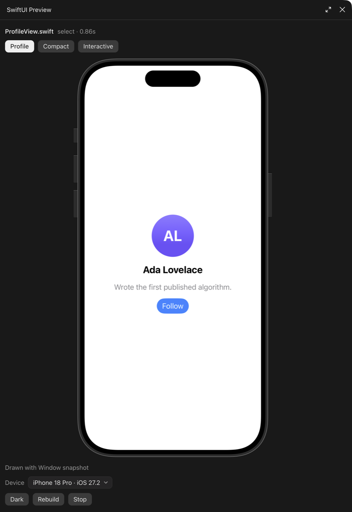

# SwiftUI previews for Bazel

SwiftUI previews with hot reload for **Bazel** projects (rules_swift +
rules_apple). Agents render them through the `swiftpreview mcp` server; the
Claude Code plugin also shows them in a pane beside the chat.

A save shows a new frame in about 0.6 s, measured with a macOS host. No Xcode
canvas and no generated `.xcodeproj` are needed. How it works and the prior art:
[DESIGN.md](DESIGN.md).

```
tools/swiftpreview/                         the CLI and MCP server: thunks, aquery, serve/snapshot/mcp
runtime/                                    SwiftPreviewRuntime, linked into the preview host
previews/defs.bzl                           swiftui_preview_host macro + transition
integrations/claude-code/swiftui-previews/  the Claude Code plugin (pane, /preview)
examples/macos/                             macOS host on released rules_swift, real SwiftUI macros (Xcode)
examples/macos_clt/                         macOS host with only the Command Line Tools (rules_swift fork)
examples/ios/                               rules_apple simulator host (Xcode)
```

## 1. Add a preview host to your workspace

`MODULE.bazel`:

```starlark
bazel_dep(name = "rules_swiftui_previews", version = "0")
local_path_override(module_name = "rules_swiftui_previews", path = "path/to/swift-agent-tools")
```

`BUILD.bazel`:

```starlark
load("@rules_swiftui_previews//previews:defs.bzl", "swiftui_preview_host")

swiftui_preview_host(
    name = "preview_host",
    platform = "ios",               # or "macos"
    deps = ["//Features/Profile"],  # swift_library targets with previews
    # simulator = "iPad Air 11-inch (M4)",  # optional default for this host
)
```

That's all the setup: there is no config file. The BUILD file is the one
place the preview setup lives:

- **Host:** `swiftpreview` finds the `swiftui_preview_host` that depends on
  the file you preview, with a `bazel query`. When several do, the pane
  offers each one as a button (or pass `--host`, or `/preview File.swift --host //label`).
- **Platform and default simulator:** `swiftui_preview_host` writes them to a
  small manifest next to the app, and the tool reads it after `bazel build`.
  Without a `simulator`, the default is a booted iPhone, else the newest one.
- **Bazel flags:** put them in `.bazelrc`.
- **Xcode:** before each build, the tool checks that Bazel's cached Xcode
  detection matches the selected Xcode. After an install, upgrade or
  `xcode-select` switch it re-fetches only that repository, which takes about
  2 s and keeps the build cache, instead of needing `bazel clean --expunge`.

Personal choices aren't project settings: the pane and `/preview` remember
your device and renderer, and the CLI takes `--simulator`, `--renderer` and
`--bazel` (default: `bazelisk`, else `bazel`).

For iOS, `--define=apple.experimental.tree_artifact_outputs=1` in `.bazelrc`
installs faster: it produces a `.app` instead of an `.ipa`.

## 2. Build the CLI

```bash
cd tools/swiftpreview && swift build -c release
```

```bash
tools/swiftpreview/.build/release/swiftpreview snapshot examples/macos_clt/Views/ProfileCard.swift
```

```bash
tools/swiftpreview/.build/release/swiftpreview serve path/to/View.swift
```

`serve` prints JSON Lines events and reads commands on stdin:
`{"cmd":"select","preview":1}`, `{"cmd":"scheme","value":"dark"}`,
`{"cmd":"open","file":"…"}`, `{"cmd":"renderer","value":"window"}`,
`{"cmd":"device","value":"iPad Air 11-inch (M4)"}`, `{"cmd":"devices"}`,
`{"cmd":"rebuild"}`, `{"cmd":"quit"}`. It also
reads them from `<session>/control.json`, and from `<session>/inbox/*.json`
(one command per file), and appends every event to `<session>/events.jsonl`.
A running `serve` registers itself in `~/Library/Caches/swiftpreview/sessions`
so other clients can find it.

## 3. Use it from an agent (MCP)

```bash
tools/swiftpreview/.build/release/swiftpreview mcp
```

is a Model Context Protocol server on stdio with three tools:

| Tool | What it does |
|---|---|
| `swiftui_preview` | Renders a preview and returns the PNG (inline image plus its path), or the compiler errors at your file and line. Takes `file`, `preview`, `colorScheme`, `device`, `renderer`, `host`. |
| `swiftui_preview_list` | Lists the previews in a file, no build needed. |
| `swiftui_preview_devices` | Lists the iOS simulators, the default pick first. |

When a preview is running for the same workspace (`swiftpreview serve`, for
example the Claude Code pane), `swiftui_preview` renders there: it hot
reloads in about a second and the person watching sees the same frame.
Otherwise it runs a one-off `snapshot`, which builds with Bazel first, in
`.swiftpreview/mcp-snapshot-<pid>` (one folder per server, removed when it
exits).

Which running preview it picks, when several agents work in one workspace:

1. One started under the same agent as this MCP server, such as that chat's
   pane.
2. Else one no running agent started, such as `swiftpreview serve` in a
   terminal.
3. Never another agent's: that agent's pane keeps showing what it asked for.

Each `serve` lists itself in `~/Library/Caches/swiftpreview/sessions` with
its parent processes. Each `swiftpreview mcp` lists itself in
`~/Library/Caches/swiftpreview/clients` with its agent: the nearest parent
process that isn't a shell.

## 4. Use it from Claude Code



The plugin lives in `integrations/claude-code/swiftui-previews`. Install it
from this repository's marketplace (see the [README](../README.md)), or load
it for development:

```bash
claude --plugin-dir integrations/claude-code/swiftui-previews
```

- `/preview path/to/View.swift [n]` opens the **SwiftUI Preview** pane. It
  hot reloads on every save (yours or Claude's) and has buttons for each
  preview, Light/Dark, Rebuild and Stop. You can also run `/preview dark`,
  `/preview rebuild` and `/preview stop`.
- The pane shows which renderer drew each frame and lets you pick one
  (`/preview renderer auto|swiftui|window`, or `--renderer` on the CLI). This applies to macOS hosts; the iOS
  host always snapshots the window.

  | Name in the pane | What it is | Good at | Watch out for |
  |---|---|---|---|
  | **Auto** (default) | SwiftUI renderer, or Window snapshot when the view has AppKit controls | the right choice per frame | |
  | **SwiftUI renderer** | SwiftUI's `ImageRenderer` | exact shapes and strokes | AppKit-backed controls (`TextField`, `NSViewRepresentable`…) can draw as placeholders |
  | **Window snapshot** | AppKit's `cacheDisplay` of the host window | draws every control | stroked capsules can show small tick marks |
- For iOS hosts the pane has a **Device** picker listing every iOS simulator
  on the machine (`swiftpreview devices` prints the same list). Picking one
  boots it if needed and installs the already-built app there, with no Bazel
  build. `/preview device` lists them; `/preview device iPhone 18 Pro`
  switches. Without a pick, the default is a booted iPhone, else the newest
  iPhone on a standard runtime. `simulator` on `swiftui_preview_host` sets a
  default for the host; your pick in the pane, or `--simulator`, wins.
- iOS frames appear inside the simulator's bezel, buttons and screen corners,
  drawn from Xcode's own device artwork
  (`/Library/Developer/DeviceKit/Chrome`), so the pane looks like Simulator.
  Only full-screen previews get the device; size-to-fit and fixed-size ones
  show as they are, as in Xcode. The PNG Claude reads stays the bare screen.
  `--frame none` turns it off.
- After Claude edits a `.swift` file while a preview runs, the mod waits for
  the reload. It then tells Claude the frame's path, or the compiler errors at
  your file and line.
- The plugin starts `swiftpreview mcp`, so Claude gets the `swiftui_preview`
  tools above and sees the frame it rendered, through the pane's session when
  one runs.

The plugin's `swiftpreviewPath` option points at the CLI. It defaults to
`swiftpreview` on your `PATH`; set it to
`/path/to/swift-agent-tools/tools/swiftpreview/.build/release/swiftpreview`
otherwise.

## What hot reloads

| Change | Result |
|---|---|
| Bodies of `body`, computed properties, functions (any type, any file in the host) | hot reload |
| New computed properties, functions, nested or top-level types | hot reload (compiled into the thunk) |
| `#Preview` contents, `@Previewable` state | hot reload |
| Stored properties, `init`s, enum cases, conformances, protocols, overrides | automatic Bazel rebuild and relaunch |
| Bazel outputs rebuilt by something else (another session, a manual `bazel build`) | detected before the next render; automatic rebuild and relaunch |

## Status

- macOS host: run end to end with Xcode 27.2 and released rules_swift 4.2.2
  (`examples/macos`, with `@State`, `#Preview` and `@Previewable`), and with
  only the Command Line Tools through a CLT-capable rules_swift fork
  (`examples/macos_clt`). Covered: hot reload (about 0.7 s), the rebuild
  fallback, compiler diagnostics and scheme switching.
- iOS simulator host: runs with Xcode 27.2, rules_apple 5.4.0 and the iOS 27.2
  simulator. Covered: build, install, launch, thunk dylibs loading in the
  simulator app, capture, and switching devices in a running session. Hot
  reload on save and the rebuild-and-reinstall path are not yet verified on iOS.

Tests:

```bash
cd tools/swiftpreview && swift test
```

With only the Command Line Tools, add
`-Xswiftc -plugin-path -Xswiftc /Library/Developer/CommandLineTools/usr/lib/swift/host/plugins/testing`.
